# การเปลี่ยนแปลง UI: เรียงสี่ และการเล่นในเครื่องเดียว

วันที่ 2026-11-03 เทียบกับ commit `52eb01f` ภาพทั้งหมดถ่ายจากแอปจริง (`wrangler dev`) บน viewport 1180×820 ขนาดเดียวกับ e2e

สรุปสั้น ๆ:

- หน้าแรกเลือกเกมได้ และมีปุ่ม "เล่นในเครื่องนี้" สำหรับเกมที่รองรับ
- เพิ่มเกมใหม่ "เรียงสี่" สำหรับ 2 คน บน iPad แนวนอน
- หน้าผลรองรับผลเสมอ และข้อความบนหัวมาจากเกมแต่ละเกม
- โหมดเล่น 2 คนในเครื่องเดียว ใช้ได้แม้ไม่มีเน็ต
- หน้าจอ Battleship ไม่เปลี่ยน

Spec ที่เกี่ยวข้อง: [Four in a Row spec](../../specs/games/four-in-a-row/spec.md), [platform spec](../../specs/platform/spec.md) (C7, L6, L7, section 13) และ [ADR-0006](../adr/0006-local-play-runs-logic-in-the-browser.md)

## 1. หน้าแรก: เลือกเกม (C7)

| ก่อน | หลัง |
|---|---|
| 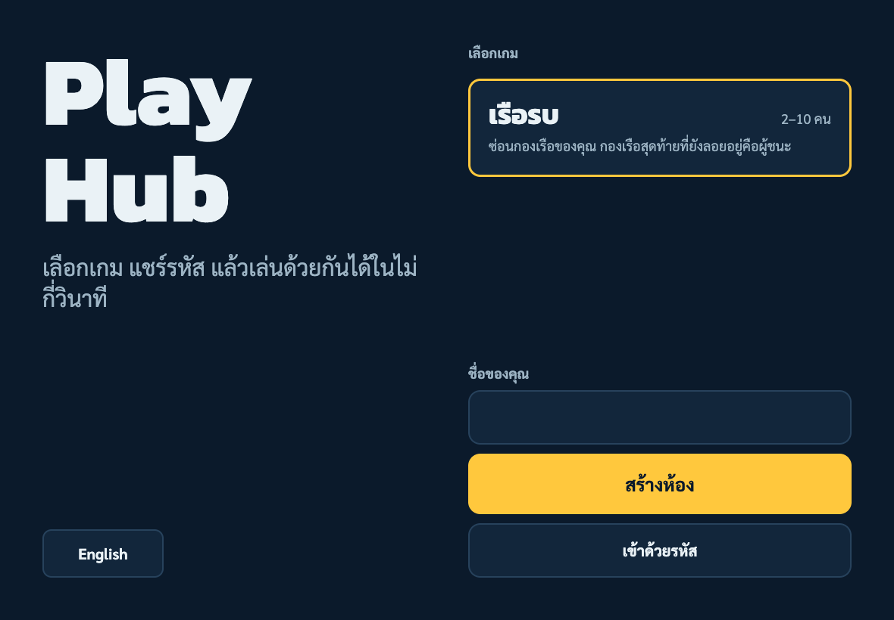 | 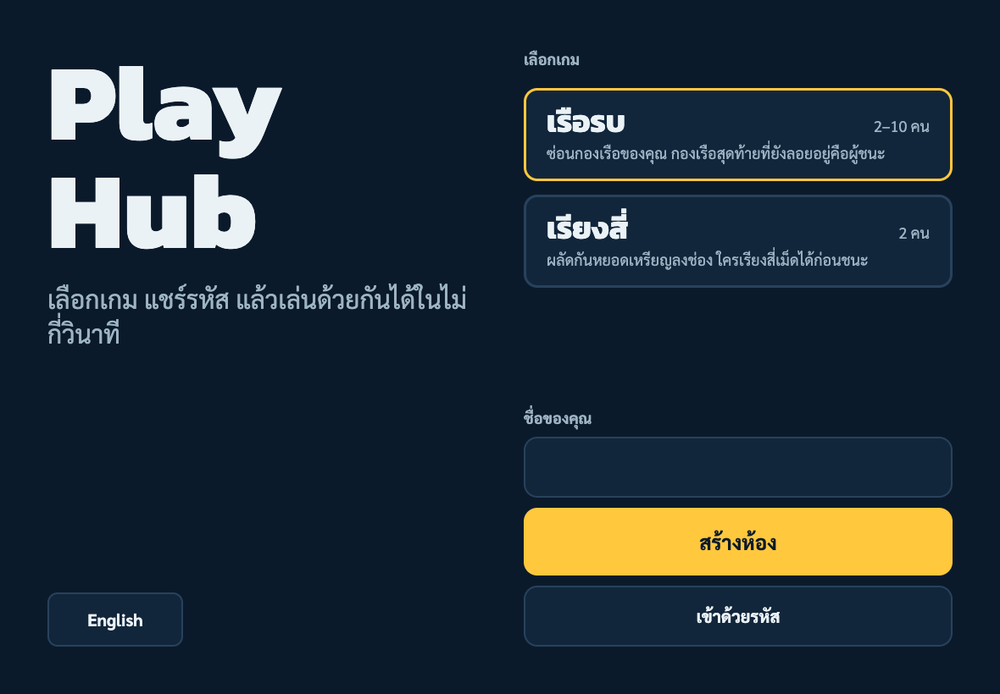 |

- การ์ดเกมกดเลือกได้ ใบที่เลือกอยู่มีขอบเหลือง ค่าเริ่มต้นคือเกมแรก (เรือรบ)
- เกมที่ผู้เล่นตายตัวแสดง "2 คน" แทน "2–2 คน"

เมื่อเลือกเรียงสี่ ปุ่ม "เล่นในเครื่องนี้" จะโผล่ข้างปุ่ม "เข้าด้วยรหัส" เพราะเรียงสี่รองรับการเล่นในเครื่อง (O1, O2) ส่วนเรือรบไม่มีปุ่มนี้

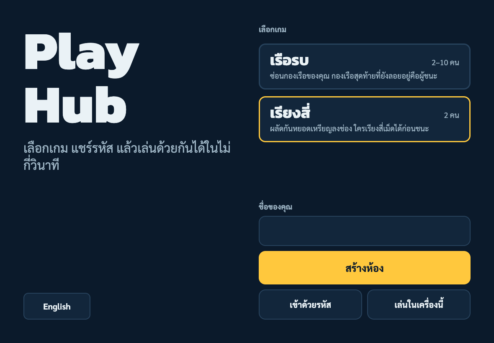

ภาษาอังกฤษใช้ชื่อ "Four in a Row" และไม่มีคำว่า "Connect Four" ที่ไหนเลย

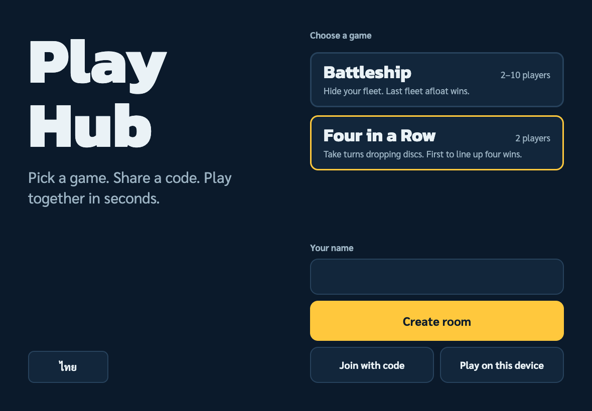

## 2. เรียงสี่: เล่นออนไลน์

### ห้องรอ

ใช้หน้าห้องรอเดิมของ platform เกมนี้ไม่มีตัวเลือก จึงไม่มีแผงตั้งค่า และห้องรับได้ 2 คน

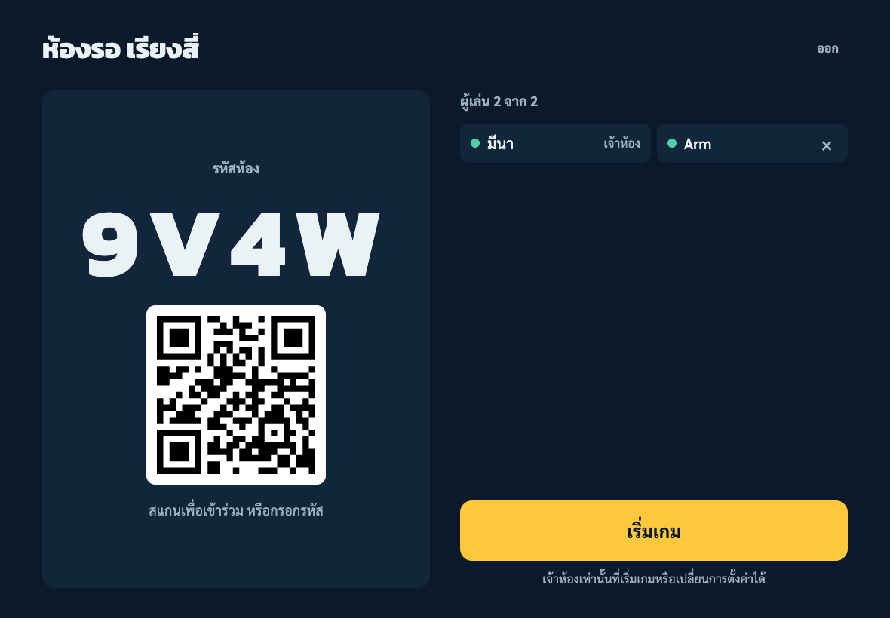

### เริ่มตาของคุณ (F20)

แถบ "ตาคุณ" กวาดผ่านจอพร้อมเสียง แบบเดียวกับ Battleship หัวจอเป็นสีเหลือง

| ระหว่างแถบกวาด | หลังแถบกวาด |
|---|---|
| 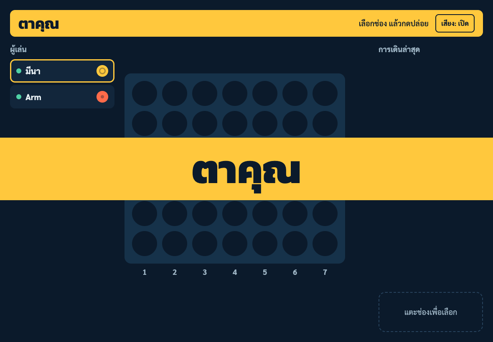 | 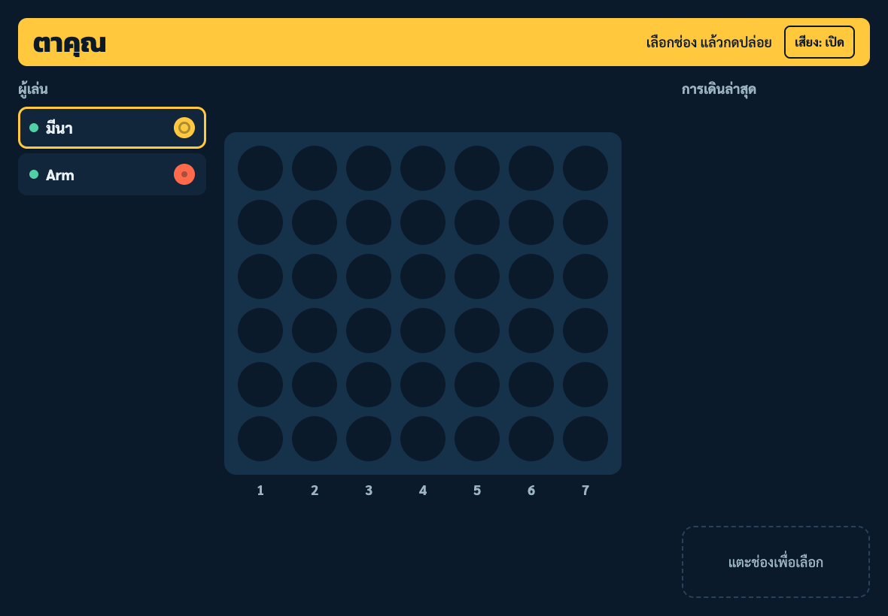 |

### เลือกช่องแล้วปล่อย (F13, F15)

- แตะตรงไหนก็ได้ในคอลัมน์เพื่อเลือก คอลัมน์ที่เลือกจะไฮไลต์ และมีเหรียญจาง ๆ สีของเราลอยอยู่ด้านบน
- กด "ปล่อยที่ช่อง N" เพื่อยืนยัน ถ้าแตะคอลัมน์อื่นก็ย้ายการเลือกได้
- คอลัมน์ที่เต็มแล้วเลือกไม่ได้ (F14)

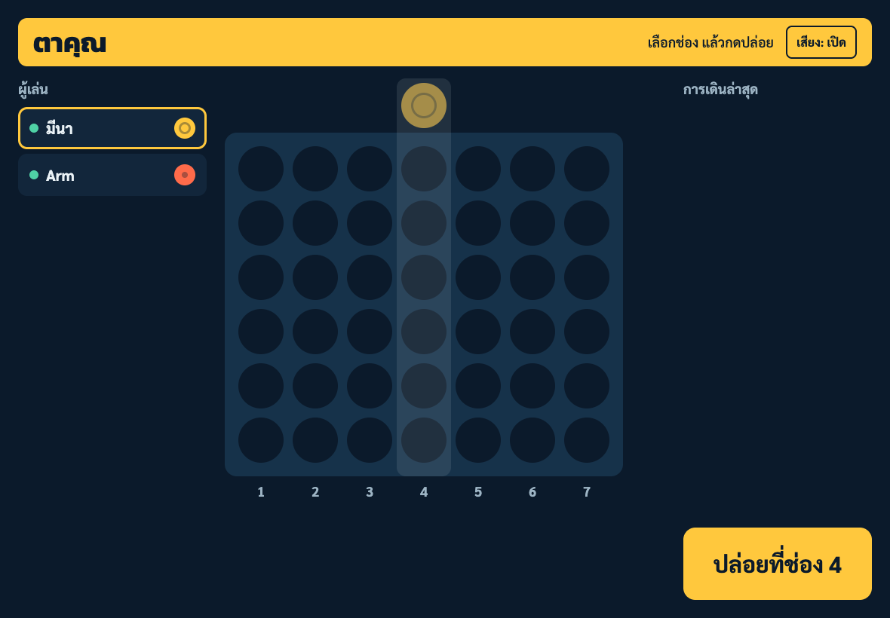

### เหรียญหล่น (F18, F19)

ทุกจอเห็นเหรียญหล่นจากแถวบนลงช่อง และหัวจอบอกว่าใครลงช่องไหน เหรียญยังไม่นับว่าลงจนกว่าจะหล่นถึง ภาพนี้ถ่ายจากจออีกฝั่งที่ตั้งให้ animation ช้าลงเพื่อให้จับภาพได้

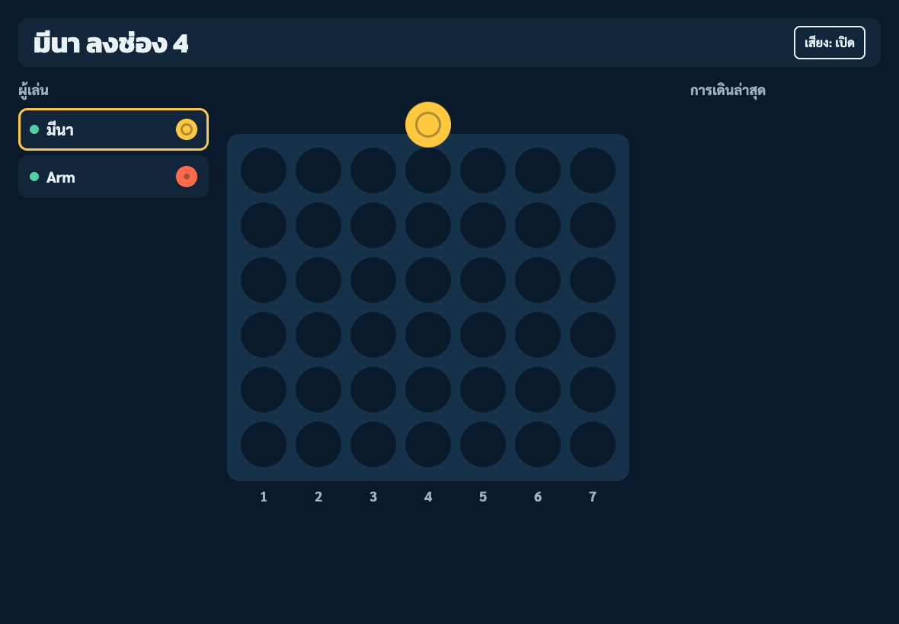

### รอตาอีกฝ่าย

- หัวจอสีเข้มเขียนว่า "ตาของ Arm / รอตาของคุณ" และกรอบเหลืองในรายชื่อชี้ว่าเป็นตาของใคร
- ด้านขวาเป็นการเดินล่าสุด 6 ตา ตาของเราเขียนว่า "คุณ"
- เหรียญเหลืองมีวงแหวน เหรียญแดงมีจุด ไว้แยกสีได้โดยไม่ต้องดูสี (F16)

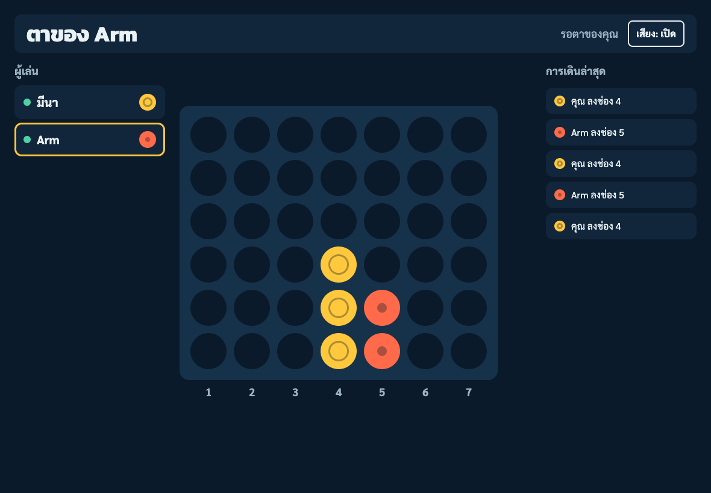

### ชนะ (F7, F8, F18)

เหรียญสี่เม็ดที่ชนะมีขอบขาวและกะพริบ ป้าย "มีนา ชนะ!" ขึ้นกลางจอ คนชนะได้ยินเสียงชนะ อีกฝ่ายได้ยินเสียงแพ้

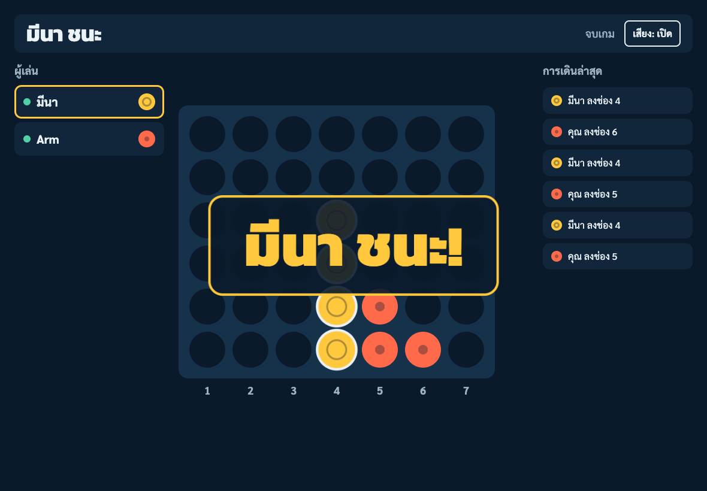

## 3. หน้าผล (L6, L7)

ข้อความบนหัวหน้าผลเดิมเขียนตายตัวว่า "กองสุดท้ายที่เหลืออยู่" ตอนนี้แต่ละเกมกำหนดเองได้ Battleship ยังได้ข้อความเดิม หน้าจอจึงเหมือนเดิมทุกอย่าง

| Battleship ก่อน | Battleship หลัง |
|---|---|
|  |  |

เรียงสี่ชนะ: หัวข้อความเป็น "เรียงสี่ได้ก่อน"

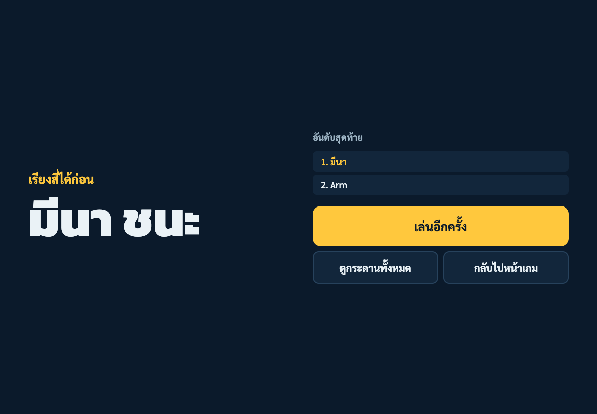

เรียงสี่เสมอ: หัวข้อความเป็น "กระดานเต็ม ไม่มีใครเรียงสี่ได้" และหัวใหญ่เป็น "เสมอ" ทั้งสองคนได้อันดับ 1 เดิมรายการอันดับนับ 1, 2 ตามลำดับเสมอ

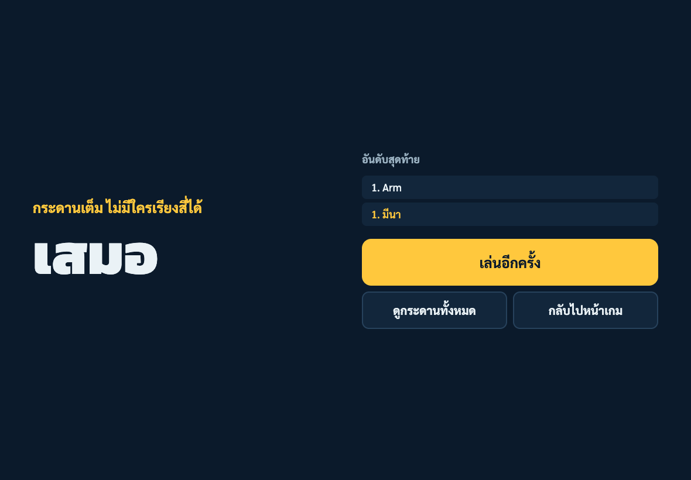

ปุ่ม "ดูกระดานทั้งหมด" เปิดกระดานสุดท้าย โดยยังมีขอบขาวที่เส้นชนะ (F17)

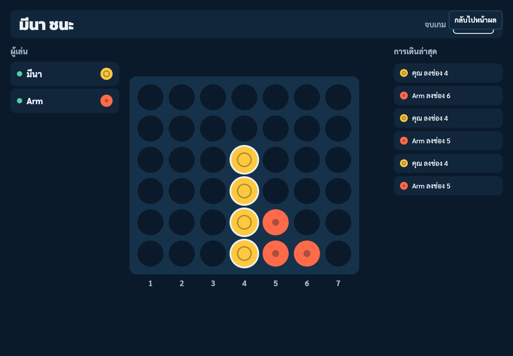

## 4. เล่นในเครื่องนี้ (O2 ถึง O7, F23)

### กรอกชื่อ

กรอกชื่อผู้เล่นทีละช่อง ใช้กฎชื่อเดียวกับออนไลน์ และชื่อห้ามซ้ำกัน

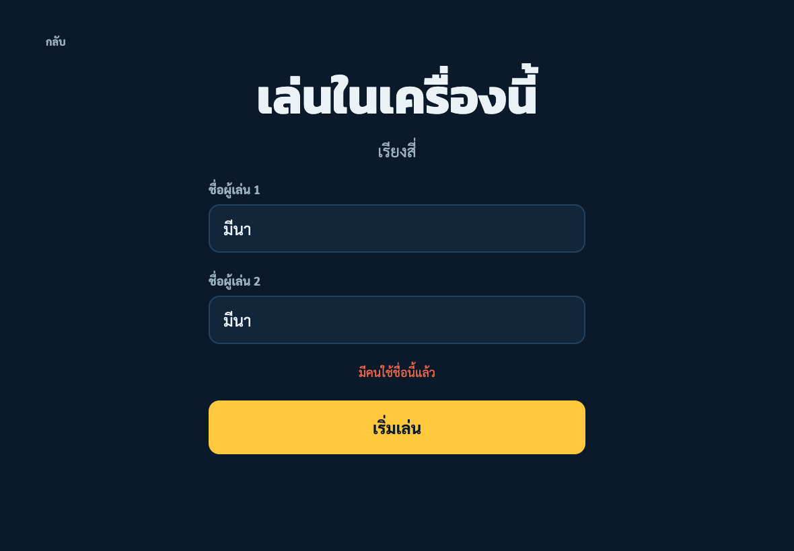

### เล่น

- ทุกตาหัวจอเป็นสีเหลือง เขียนว่า "ตาของ X" แทน "ตาคุณ" เพราะทุกคนใช้เครื่องเดียวกัน
- แถบกวาดบอกชื่อคนที่ถึงตาทุกครั้ง ส่งเครื่องต่อกันได้
- log ใช้ชื่อจริงทุกตา ไม่มีคำว่า "คุณ"

| แถบกวาดบอกชื่อ | เลือกช่องอยู่ |
|---|---|
| 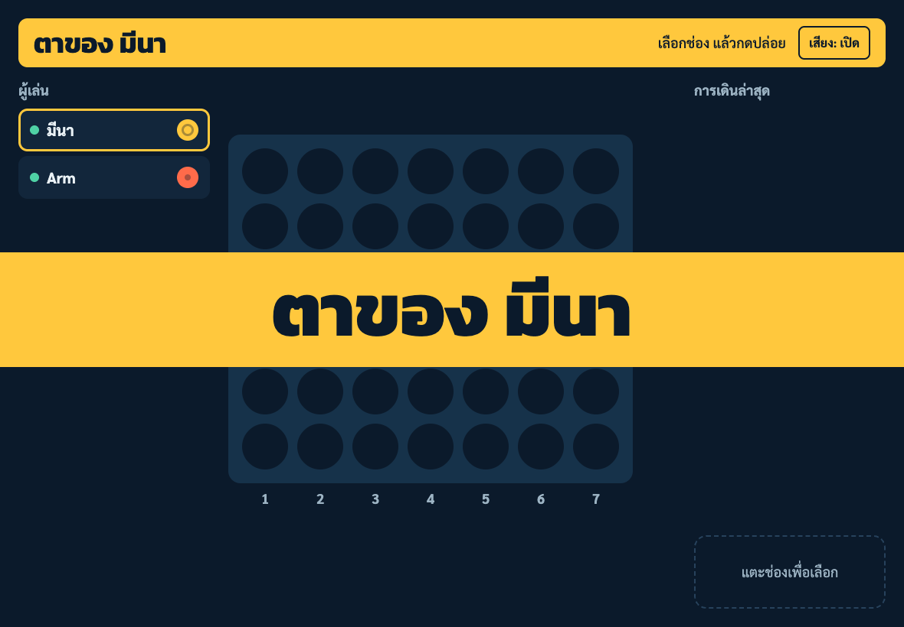 | 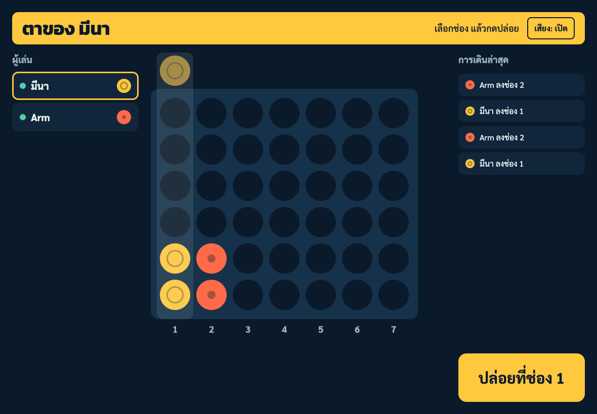 |

### จบเกม

ป้ายชนะใช้ชื่อจริง ส่วนหน้าผลใช้หน้าเดียวกับออนไลน์ ไม่ไฮไลต์ใครในอันดับ และ "เล่นอีกครั้ง" เริ่มใหม่ด้วยชื่อเดิม

| ป้ายชนะ | หน้าผล |
|---|---|
| 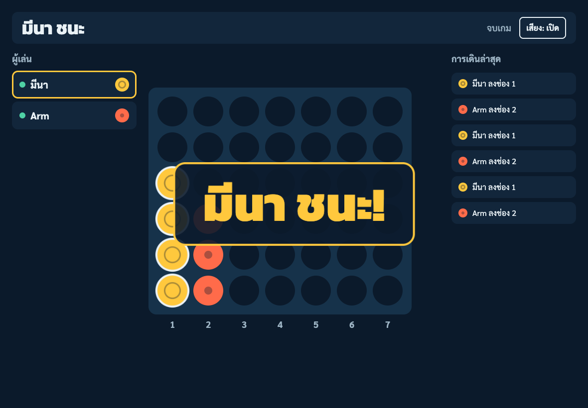 |  |

## 5. ปัญหาที่เห็นจากภาพ ยังไม่ได้แก้

1. **ปุ่ม "กลับไปหน้าผล" ทับปุ่มเสียง** บนกระดานสุดท้าย (ภาพ `four-final-board.png`) ปุ่มของ platform วางตายตัวที่มุมขวาบน ซึ่งตรงกับปุ่มเสียงของเรียงสี่ ใน Battleship ไม่เห็นปัญหานี้เพราะหน้ากระดานสุดท้ายไม่มีปุ่มเสียง
2. **ป้ายชนะบังเส้นที่ชนะ** ถ้าเส้นอยู่กลางกระดาน (ภาพ `four-win-banner.png`) ป้ายจะบังเหรียญที่กะพริบไป 2 เม็ด
3. **ยังไม่มี design mockup** ใน `design/` สำหรับหน้าจอเหล่านี้ เพราะข้ามขั้นตอนอนุมัติ design ไป ภาพในเอกสารนี้คือหน้าจอที่ทำเสร็จแล้ว

## 6. สิ่งที่ยังไม่ได้ตรวจ

- ยังไม่ได้ลองบน iPad จริง ทั้งการแตะ เสียง และป้ายต่าง ๆ
- ยังไม่ได้ฟังเสียงใหม่ทั้ง 6 ตัวด้วยหู
- ถ้าเครื่องเปิดเรียงสี่ครั้งแรกตอนไม่มีเน็ต ตัวหนังสือบางน้ำหนักจะใช้ฟอนต์สำรองแทน เพราะฟอนต์ถูก cache ตอนใช้ครั้งแรก (C6)
