# การเปลี่ยนแปลง UI: ใบ้เรียง และหน้าจอมือถือแนวตั้ง

วันที่ 2026-11-04 เทียบกับ commit `c53fe78` ภาพทั้งหมดถ่ายจากแอปจริง (`wrangler dev`) ภาพมือถือใช้ขนาด 390×844 และภาพ iPad ใช้ 1180×820

Design ที่อนุมัติแล้ว: [canvas](https://claude.ai/artifact/U4UUqVmZ1jDyCjcFeXZcPQ) (สำเนาอยู่ที่ `design/bai-riang/`) · Spec: [ใบ้เรียง](../../specs/games/bai-riang/spec.md), [platform](../../specs/platform/spec.md) C5, L8 ถึง L10 · [ADR-0007](../adr/0007-two-fixed-frames-by-orientation.md)

สรุป:

- เพิ่มเกม "ใบ้เรียง" สำหรับ 2 ถึง 10 คน เป็นเกมร่วมมือ เล่นบนมือถือแนวตั้งหรือ iPad แนวนอน
- หน้า platform (หน้าแรก เข้าห้อง ห้องรอ หน้าผล) รองรับมือถือแนวตั้ง
- หน้าผลรองรับผลแบบทีม: ทีมชนะ หรือทีมแพ้
- ปุ่ม "กลับไปหน้าผล" ย้ายไปอยู่กลางด้านล่าง จึงไม่ทับปุ่มเสียงของเรียงสี่แล้ว
- Battleship และเรียงสี่บน iPad แนวนอนหน้าตาเหมือนเดิม ถ้าเปิดบนมือถือแนวตั้ง จะแสดงเล็กลงพร้อมข้อความให้หมุนจอ

## 1. หน้า platform บนมือถือ (C5)

| หน้าแรก | เข้าห้อง | ห้องรอ เลือกหัวข้อได้ (N1) |
|---|---|---|
| 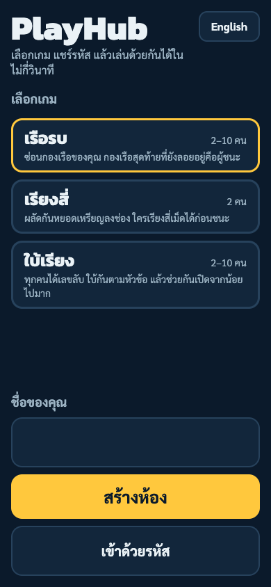 | 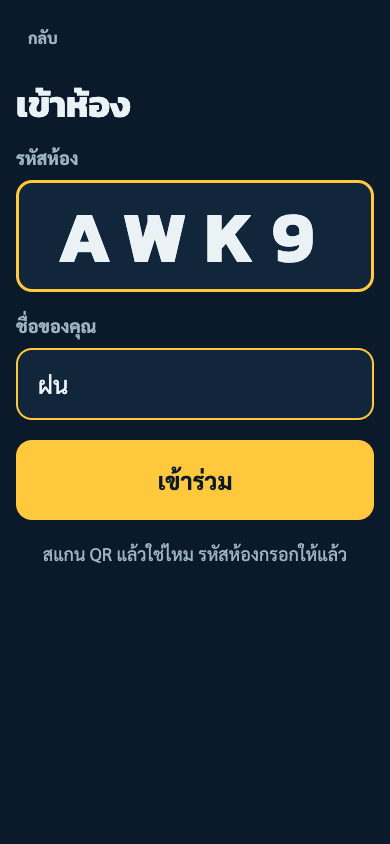 | 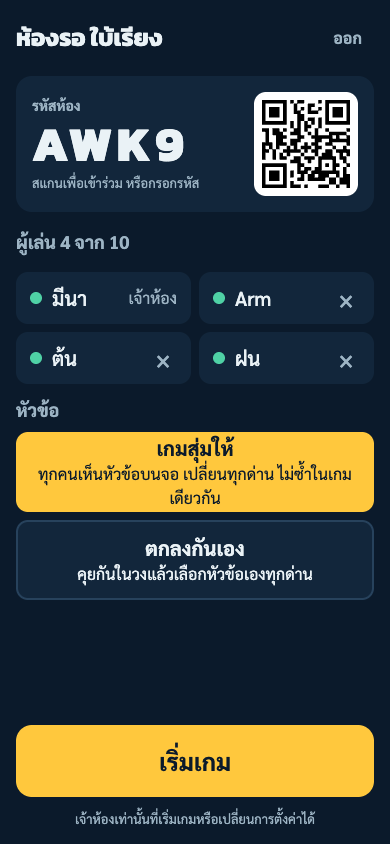 |

## 2. ใบ้เรียง: เล่น

| เริ่มด่าน 1 | กดค้าง แถบเดินที่ขอบล่าง (N16) | ซ่อนเลข (N17) |
|---|---|---|
| 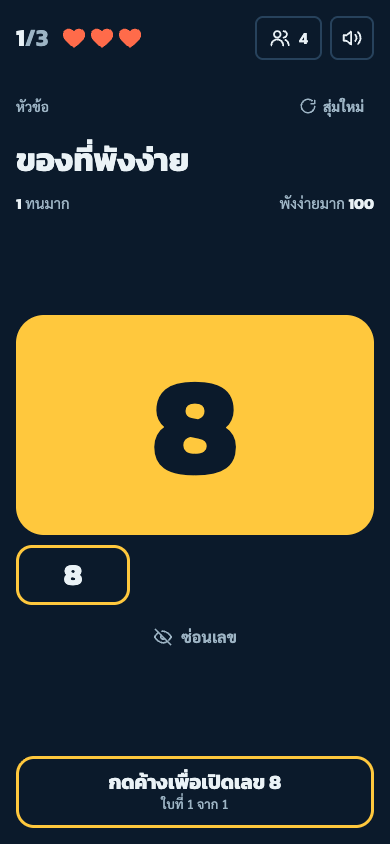 | 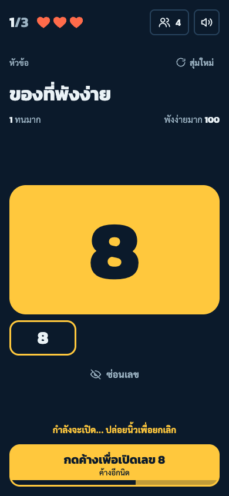 | 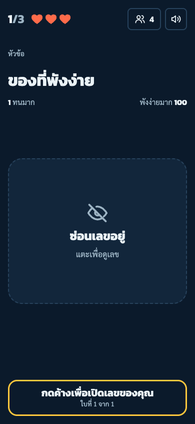 |

| Sheet ดูวง (N18) | เปิดพลาด (N7, N21) | ผ่านด่าน (N19) |
|---|---|---|
| 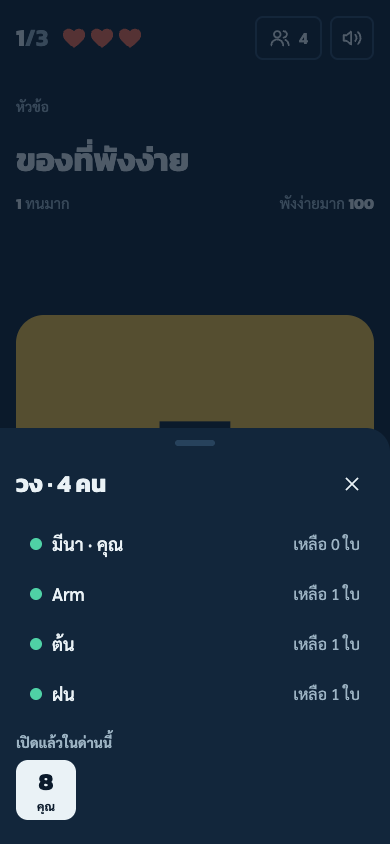 | 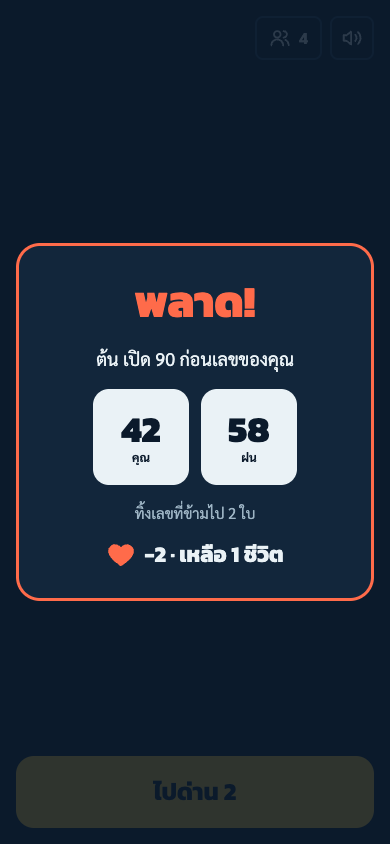 | 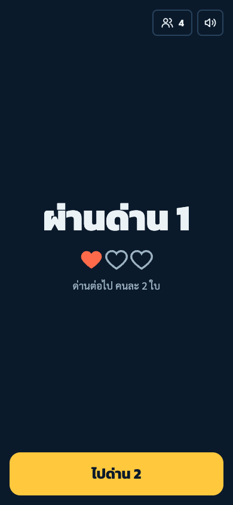 |

ทุกด่านใช้ layout เดียวกัน (N15) ส่วนที่ต่างกันคือจำนวนช่องในแถบการ์ดเล็ก

| ด่าน 2 (2 ใบ) | ด่าน 3 (3 ใบ) |
|---|---|
| 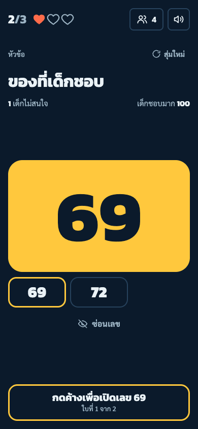 | 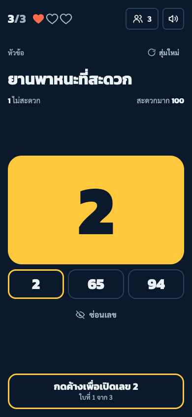 |

บน iPad แนวนอน หัวข้ออยู่ซ้าย ส่วนการ์ดและปุ่มอยู่ขวา

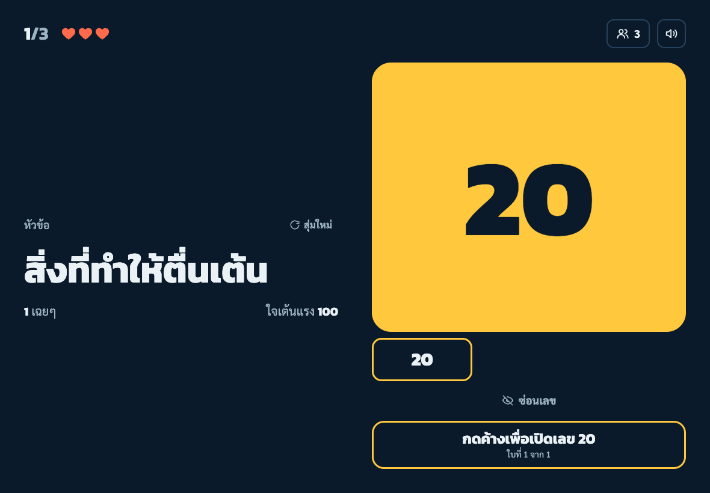

## 3. หน้าผลแบบทีม (L8, L9)

หัวใหญ่บอกว่าทีมชนะหรือแพ้ บรรทัดบนมาจากเกม ("ผ่านครบ 3 ด่าน" หรือ "ชีวิตหมดที่ด่าน n") รายชื่อไม่มีลำดับ และปุ่มด้านล่างเปลี่ยนชื่อเป็น "ดูลำดับที่เปิด" (L10)

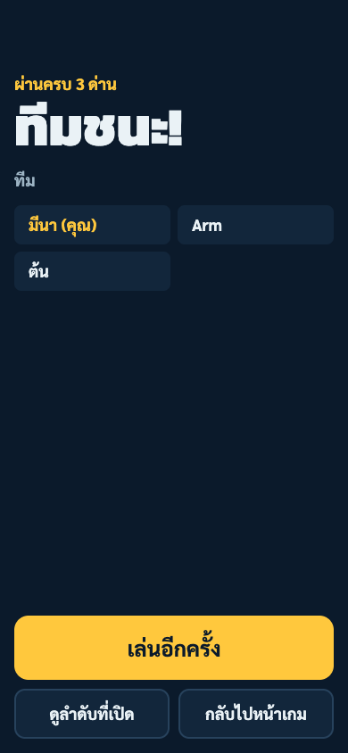

## 4. ที่ต่างจาก design

- แถวรายชื่อใน sheet มีสีเดียวกับพื้นของ sheet ส่วนใน design แถวเป็นสีเข้มกว่า
- ป้ายเปิดพลาดแสดงเลขที่ถูกทิ้งเป็นการ์ดพร้อมชื่อเจ้าของ แต่ไม่ได้ขีดฆ่าเลขบนการ์ด
- ถ้าด่านจบพร้อมกับการพลาด ป้ายพลาดจะขึ้นทับหน้าผ่านด่าน

## 5. สิ่งที่ยังไม่ได้ตรวจ

- ยังไม่ได้ลองกดค้าง ซ่อนเลข และเปิด sheet บนมือถือหรือ iPad จริง
- ยังไม่ได้ฟังเสียงใหม่ทั้ง 5 ตัวด้วยหู
- หัวข้อทั้ง 200 ข้อยังรอคุณ review
