# การเปลี่ยนแปลง UI: สลับร่าง

วันที่ 2026-11-04 เทียบกับ commit `559a6a8` ภาพทั้งหมดถ่ายจากแอปจริง (`wrangler dev`) ภาพมือถือใช้ขนาด 390×844 และภาพ iPad ใช้ 1180×820

Design ที่อนุมัติแล้ว: [canvas](https://claude.ai/artifact/XmYj8prqXqKD8xena1n7DG) (สำเนาอยู่ที่ `design/salab-rang/`) · Spec: [สลับร่าง](../../specs/games/salab-rang/spec.md), [platform](../../specs/platform/spec.md) R6, L11

สรุป:

- เพิ่มเกม "สลับร่าง" สำหรับ 4 ถึง 10 คน เป็นเกมโม้ ใช้มือถือแต่ละเครื่องเป็นการ์ด 1 ใบ เล่นได้ทั้งมือถือแนวตั้งและ iPad แนวนอน
- ตัวละคร 13 ตัว และชุดการ์ด 4 แบบ (เริ่มต้น วุ่นวาย สุ่ม กำหนดเอง)
- platform: เกมห้ามกดเริ่มได้เมื่อตั้งค่าไม่ครบ (L11) ชื่อผู้เล่นยาวได้สูงสุด 10 ตัว (R6) และห้องรอบนมือถือเลื่อนดูได้เมื่อมีผู้เล่นเยอะ
- หน้าแรกเปลี่ยนรายการเกมเป็นตาราง 2 คอลัมน์ที่เลื่อนได้ (C8) เพราะพอมี 4 เกม ปุ่มสร้างห้องบน iPad หลุดจอ

## 1. หน้าแรก (C7, C8)

ก่อนแก้ มี 4 เกม iPad ล้นจอ ปุ่ม "สร้างห้อง" โดนตัดและปุ่ม "เข้าด้วยรหัส" หายไป หลังแก้ เกมเป็นตาราง 2 คอลัมน์ มีชื่อกับจำนวนคน คำอธิบายของเกมที่เลือกอยู่ใต้ตาราง ถ้าเกมเยอะเกินจอตารางจะเลื่อนได้ ช่องกรอกชื่อกับปุ่มอยู่กับที่

| ก่อน: iPad | หลัง: iPad |
|---|---|
| 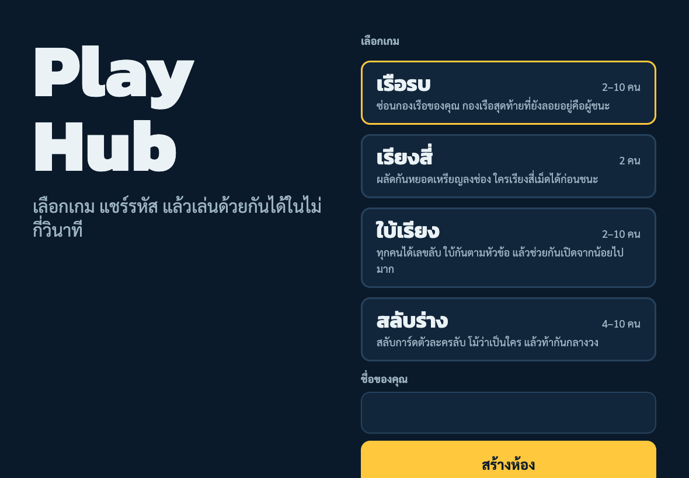 | 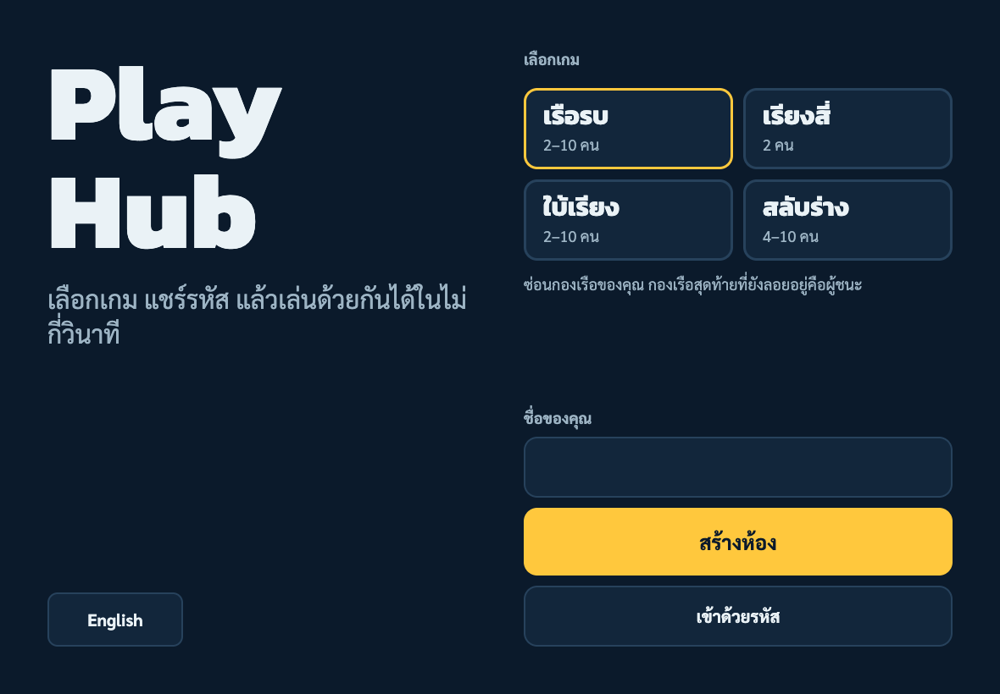 |

| ก่อน: มือถือ | หลัง: มือถือ | ทดลองใส่ 20 เกม: ตารางเลื่อน |
|---|---|---|
| 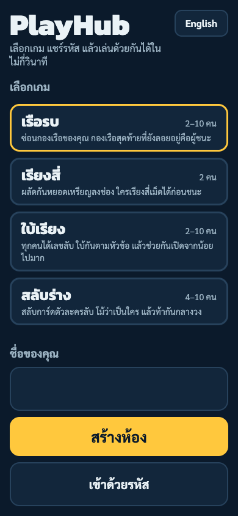 | 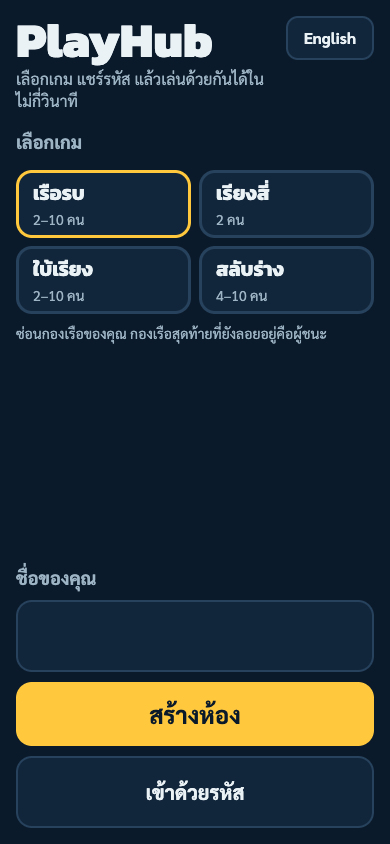 | 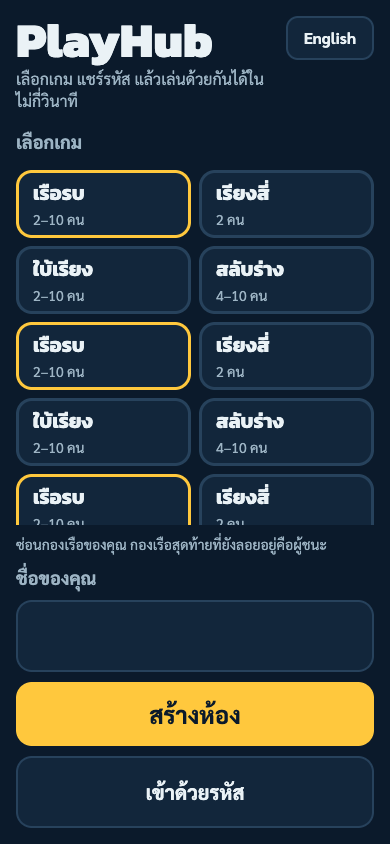 |

## 1b. ห้องรอ (W1, W40, L11, R6)

| ชุดกำหนดเองที่ยังเลือกไม่ครบ: ปุ่มเริ่มกดไม่ได้ | 10 คนบนมือถือ เลื่อนดูได้ | ชื่อยาวถูกตัดที่ 10 ตัว |
|---|---|---|
| 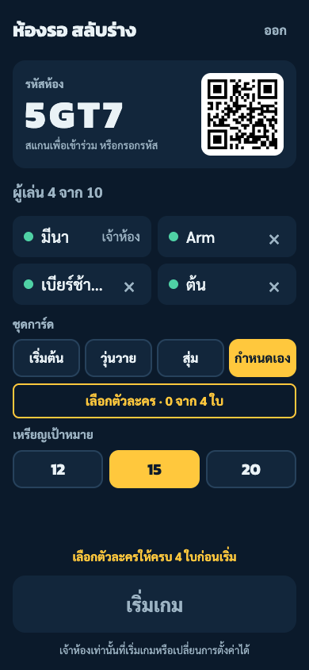 | 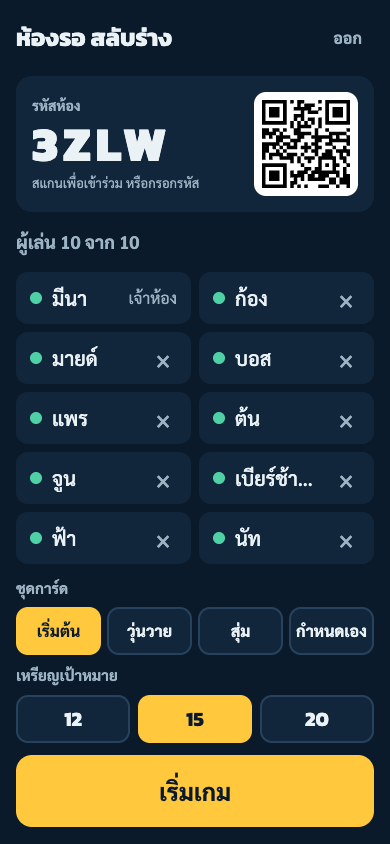 | พิมพ์ "เบียร์ช้างน้อยมาก" แล้วได้ "เบียร์ช้างน้อย" |

## 2. เริ่มเกมและตาของเรา

| จำการ์ด (W9) | จำการ์ด 10 คน: แถบ 2 แถว (W32) | ตาของเรา (W11 ถึง W13) |
|---|---|---|
| 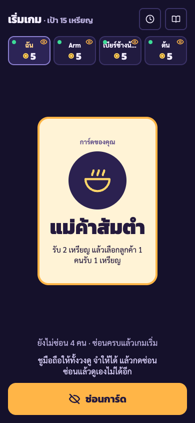 | 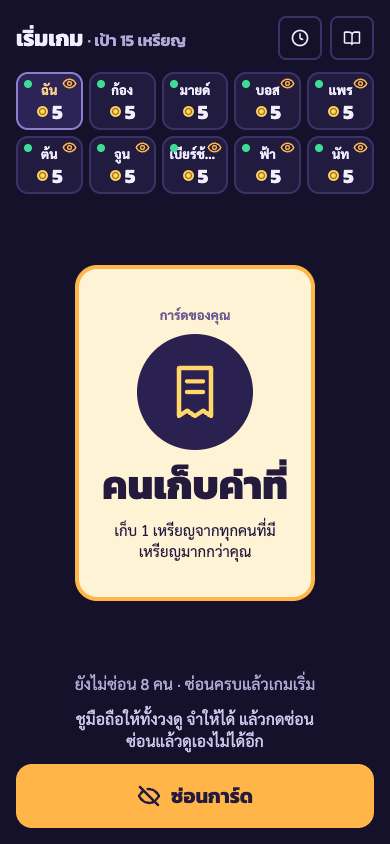 | 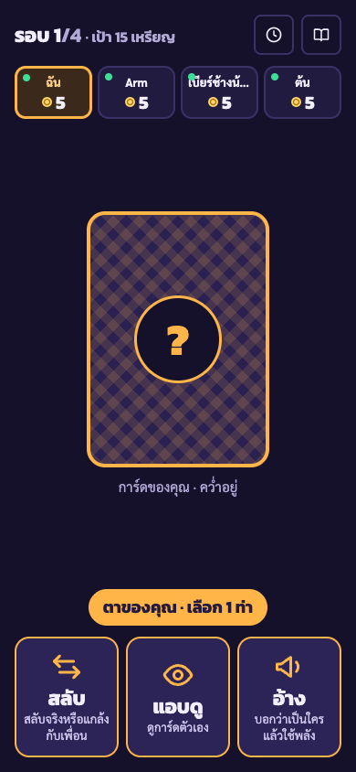 |

| สลับ: เลือกบนแถบ (W11, W33) | อ้าง (W13) | ตาเริ่มพร้อมป้ายสิ่งที่เพิ่งเกิด (W39) |
|---|---|---|
| 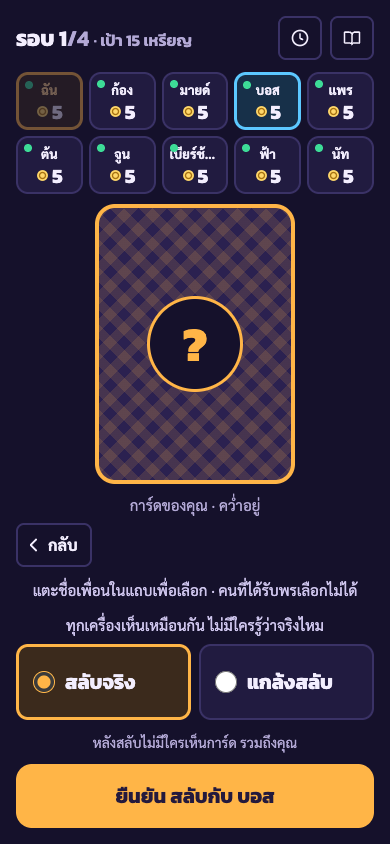 | 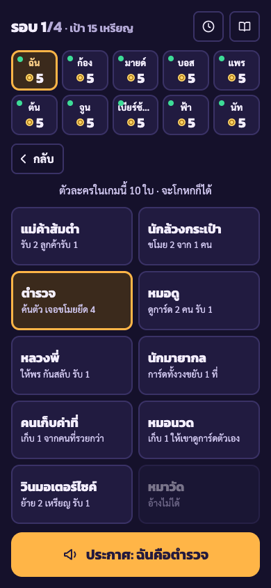 | 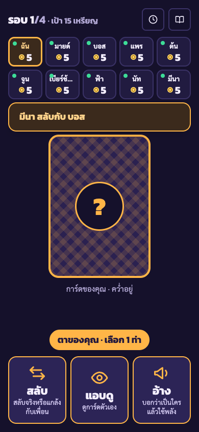 |

## 3. ท้าและเปิดการ์ด

| ช่วงท้า (W14, W35) | คนที่อ้างผิด: ชูมือถือ (W36) | คนอื่นเห็นการ์ดที่เปิด |
|---|---|---|
| 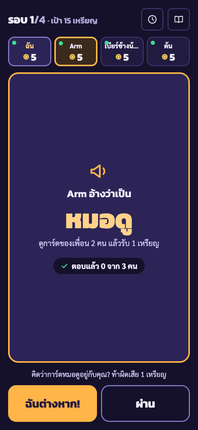 | 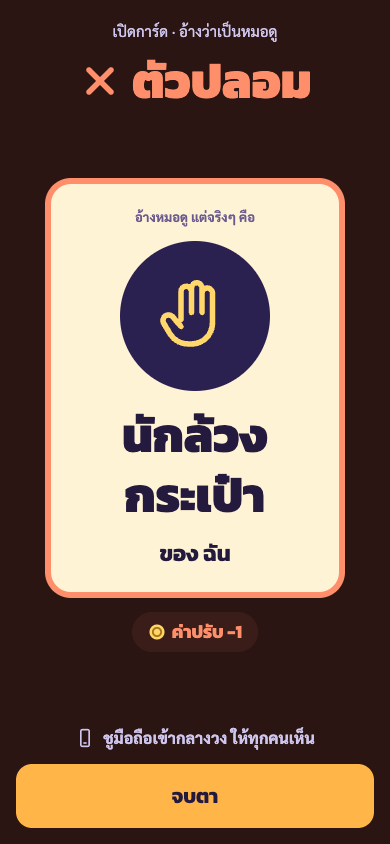 | 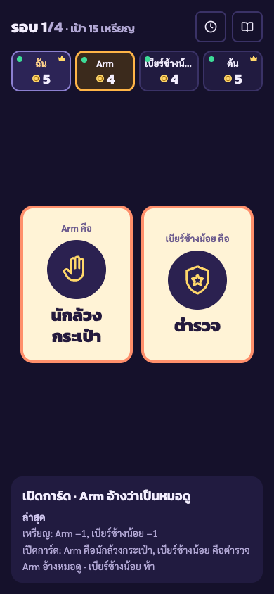 |

## 4. ใช้พลัง

| หมอดูเลือก 2 คนบนแถบ (W33) | กดค้างดูผลลับ (W21, W34) |
|---|---|
| 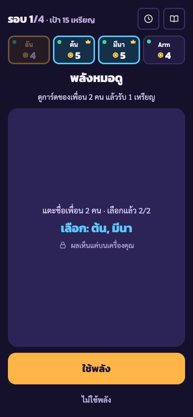 | 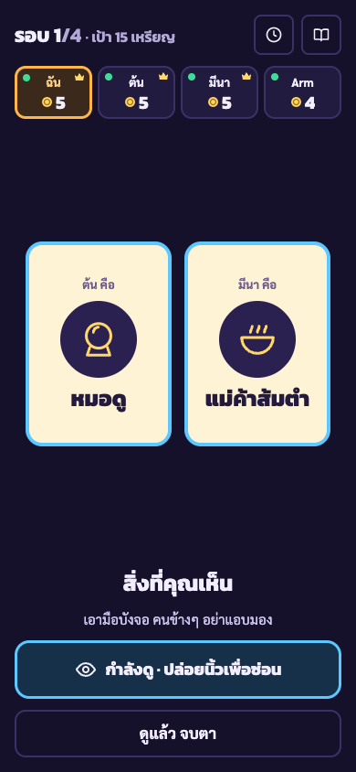 |

## 5. แผ่นข้อมูลและ iPad

| คู่มือตัวละคร (W39) | ประวัติ (W39) |
|---|---|
| 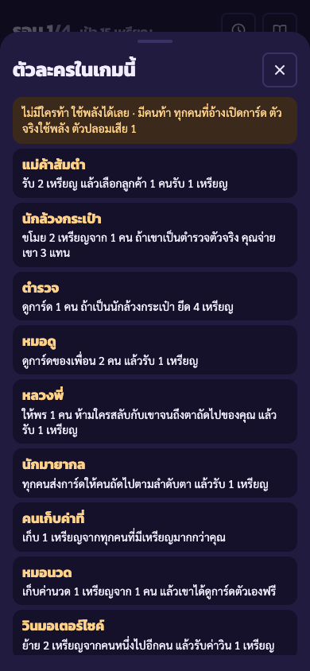 | 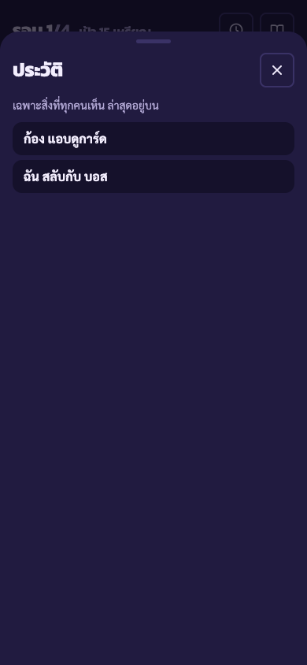 |

บน iPad แนวนอน การ์ดอยู่ซ้าย ปุ่มอยู่ขวา และแถบผู้เล่นเรียงแถวเดียวครบ 10 คน

| จำการ์ด | รอคนอื่น 10 คน |
|---|---|
| 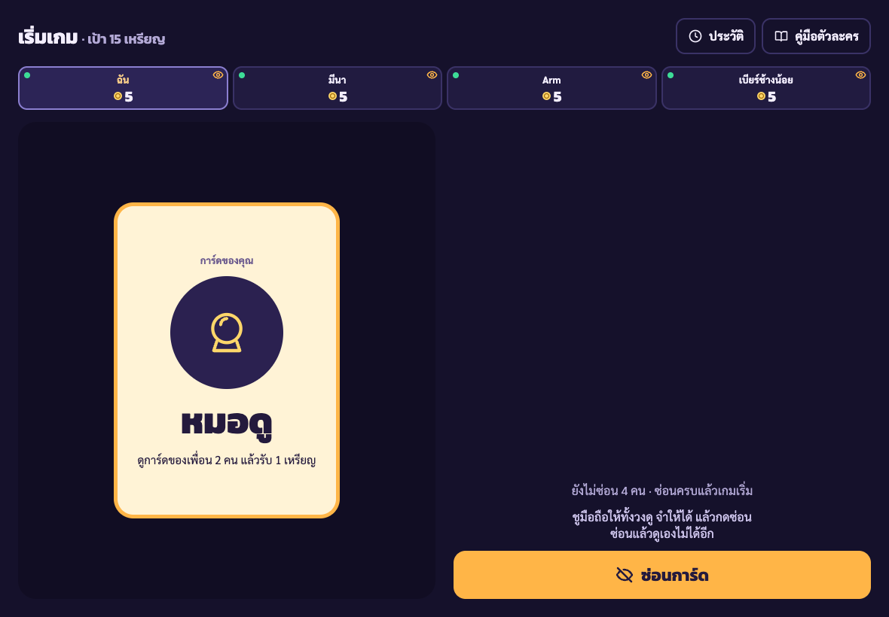 | 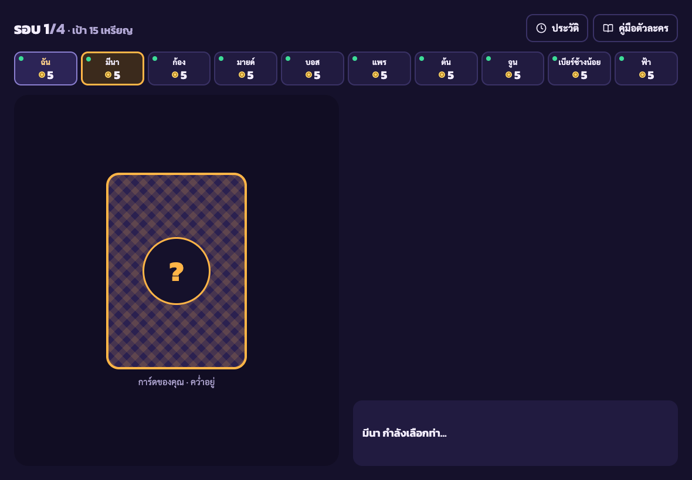 |

## 6. จบเกม (W26, W41)

หน้าผลของ platform บอกเหตุที่ตลาดปิด ปุ่ม "ดูการ์ดสุดท้าย" เปิดรายชื่อการ์ดจริงของทุกคนพร้อมเหรียญ

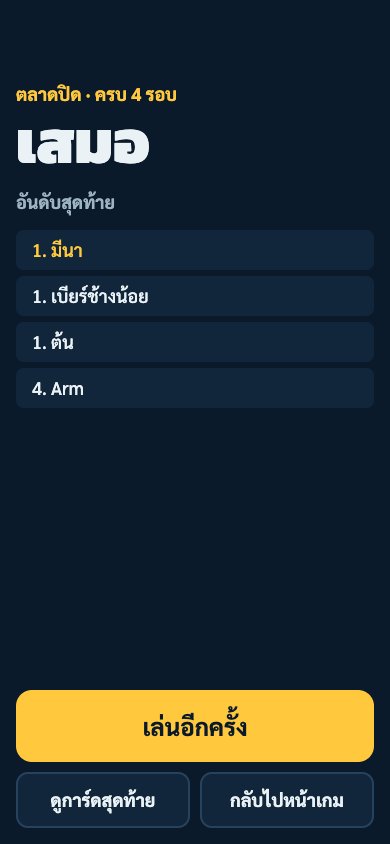

## 7. ที่ต่างจาก design

- ห้องรอใช้สีของ platform (กรมท่า) ไม่ใช่สีม่วงแบบใน design เพราะห้องรอเป็นหน้ากลางของทุกเกม ปุ่มชุดการ์ดบนมือถือแสดงแค่ชื่อ ไม่มีคำอธิบาย
- การเลือกตัวละครเองเป็นหน้าต่างทับห้องรอ ไม่ใช่หน้าแยก
- ไม่มีปุ่มปิดเสียง เพราะเกมนี้ไม่มีเสียง
- หน้าจอ "จับได้คาหนังคาเขา!" ไม่ได้ทำเป็นหน้าเต็มแยก เหตุการณ์แบบนี้แสดงเป็นข้อความในกล่อง "ล่าสุด" ประวัติ และป้ายตอนเริ่มตาถัดไป
- ป้ายเหตุการณ์ขึ้นเฉพาะตอนเริ่มตาของเรา ส่วนจอรอคนอื่นแสดงเหตุการณ์ล่าสุด 3 บรรทัดแทน
- ไอคอนตัวละครเป็นเส้นเรียบง่าย ยังไม่มีภาพประกอบ

## 8. สิ่งที่ยังไม่ได้ตรวจ

- ยังไม่ได้ลองบนมือถือหรือ iPad จริง โดยเฉพาะการกดค้างเพื่อดูการ์ด
- เทสต์ในเบราว์เซอร์ลองพลังผ่านหน้าจอแค่หมอดู พลังทั้ง 13 ตัวผ่านเทสต์ logic แต่หน้าจอของพลังอื่น (เลือกต้นทางปลายทางของวิน, ร่างทรง, ป้าขี้เม้าท์, หมอนวด, นักเลง, วงแหวนนักมายากล) ยังไม่ได้ถ่ายภาพจากแอปจริง
- ยังไม่ได้เล่นจริงกับเพื่อนเพื่อปรับสมดุลเหรียญ (เริ่ม 5 เป้า 15 สูงสุด 4 รอบ)
- ข้อความภาษาอังกฤษยังไม่มีใครรีวิว
